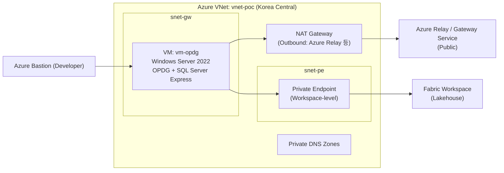

# PoC 계획: On-premises Data Gateway + Fabric Private Link 적재 검증 (최소 구성)

## 1. 배경 및 목적

### 1.1 고객 요청
- 온프렘에 설치된 **On-premises Data Gateway(OPDG)**에서 **SAP BW 커넥터**로 데이터를 읽습니다.
- 읽은 데이터를 **Private Endpoint(Private Link)가 적용된 Fabric**에 적재하려고 합니다.

### 1.2 Microsoft 공식 입장 (2026-11 기준)
| 문서 | 내용 |
|---|---|
| [Fabric Private Links 개요](https://learn.microsoft.com/en-us/fabric/security/security-private-links-overview) | Private Link가 켜져 있으면 OPDG는 지원되지 않고 **등록도 실패**합니다. VNet Data Gateway는 동작합니다. |
| [OPDG 설치 문서](https://learn.microsoft.com/en-us/data-integration/gateway/service-gateway-install) | Private Link 환경에서 OPDG는 **미지원**입니다. 대신 VNet Data Gateway를 권장합니다. |
| [Workspace-level Private Link 지원 범위](https://learn.microsoft.com/en-us/fabric/security/security-workspace-level-private-links-support) | Dataflow Gen2는 **VNet Data Gateway 연결이 필수**입니다. |

### 1.3 PoC 목적
SAP BW 커넥터 자체는 검증 대상이 아닙니다. 아래 **OPDG와 Private Link의 조합**만 실제로 확인합니다.
1. Workspace-level Private Link로 Public 접근을 막은 Workspace에 OPDG로 적재가 되는지 확인합니다.
2. 적재 데이터가 Private Endpoint 경로로 들어가는지 확인합니다.
3. 결과를 근거로 고객에게 권장 아키텍처를 제시합니다.

> 동작하는 것으로 확인되더라도, Microsoft 문서상 "미지원" 구성이면 운영 환경에 적용하기 어렵습니다. 이 PoC의 결과는 **사실 확인과 리스크 판단 자료**로 사용합니다.

---

## 2. 최소 구성 아키텍처

온프렘 환경은 Azure VNet 안의 VM으로 대신합니다. SAP BW는 **SQL Server Express**로 대체합니다. SQL Server는 OPDG를 통한 Copy Job, Pipeline, Dataflow Gen2를 모두 지원하는 소스입니다.

> 실제 고객사 환경에서는 온프렘과 Azure를 ExpressRoute 또는 VPN으로 연결하고, 온프렘 DNS가 Azure Private DNS로 조건부 전달(Private Resolver 경유)되어야 합니다. PoC는 단일 VNet으로 단순화하므로 이 부분은 [8. 운영 환경 적용 시 추가 고려사항](#8-운영-환경-적용-시-추가-고려사항)에서 따로 다룹니다.

### 2.1 Azure 리소스

| 리소스 | 스펙/설정 | 비고 |
|---|---|---|
| Resource Group | `rg-***-fabric-gw-poc` | PoC가 끝나면 통째로 삭제합니다. |
| VNet | `vnet-poc` 10.10.0.0/24 | |
| Subnet | `snet-gw` 10.10.0.0/27, `snet-pe` 10.10.0.32/27 | |
| VM | Standard_D4s_v5, Windows Server 2022 | OPDG 최소 사양(4 Core)을 충족합니다. 테스트할 때만 켭니다. |
| NAT Gateway | `snet-gw`에 연결 | OPDG가 Azure Relay 등으로 나가는 Outbound 통신에 필요합니다. |
| Azure Bastion | Developer SKU | VM 접속용입니다. Public IP를 VM에 붙이지 않습니다. |
| Private Endpoint (Workspace) | 대상: `Microsoft.Fabric/privateLinkServicesForFabric` | 시나리오 S3에서 사용합니다. |
| Private DNS Zone | `privatelink.fabric.microsoft.com` | `vnet-poc`에 Link합니다. |

### 2.2 Fabric 리소스

| 리소스 | 설정 | 비고 |
|---|---|---|
| Fabric Capacity | **F2** | Private Link는 Trial Capacity를 지원하지 않습니다. Workspace-level Private Link는 F SKU만 지원합니다. 테스트하지 않을 때는 Pause합니다. |
| Workspace A | `ws-poc-baseline` + Lakehouse `lh_poc` | Baseline(S0)용입니다. |
| Workspace B | `ws-poc-wspl` + Lakehouse `lh_poc` | Workspace-level 시나리오(S3)용입니다. **Semantic Model, Deployment Pipeline을 만들지 않습니다.** 이 항목이 있으면 Inbound 제한을 켤 수 없습니다. |
| Gateway Connection | SQL Server (`vm-opdg\SQLEXPRESS`, DB `pocdb`) | |

### 2.3 테스트 데이터
- SQL Server Express에 `pocdb.dbo.sales_sample` 테이블을 만들고 약 10만 행을 넣습니다. 적재량은 검증 대상이 아니므로 소량이면 됩니다.

---

## 3. 사전 확인 사항 (중요)

| # | 항목 | 담당 |
|---|---|---|
| P1 | 테넌트 설정을 바꿔야 하므로 운영 테넌트가 아닌 **별도의 테스트 테넌트**를 확보합니다. | MS / 고객 |
| P2 | 테스트 테넌트의 Fabric 관리자 권한을 확보합니다. Tenant Setting을 바꾸려면 필요합니다. | MS |
| P3 | Azure 구독 권한을 확보합니다. Owner 또는 Contributor + Network Contributor가 필요합니다. | MS |
| P4 | 테넌트 Home Region과 Capacity Region을 확인합니다. Korea Central을 권장합니다. | MS |
| P5 | Tenant Setting "Configure workspace-level inbound network rules"를 켤 수 있는지 확인합니다. S3에 필요합니다. | MS |
| P6 | 고객사 운영 환경 정보를 받습니다. 적재 대상 Workspace, 사용할 Fabric 항목(Pipeline, Copy Job, Dataflow Gen2) | 고객 |

---

## 4. 테스트 시나리오

### 4.1 시나리오 매트릭스

| ID | Workspace PL (Inbound 제한) | 확인 내용 | 문서 기준 예상 결과 |
|---|---|---|---|
| **S0** | Off | Baseline: OPDG 등록과 적재 | 성공 |
| **S3-a** | **On** (ws-poc-wspl) | OPDG로 Pipeline 또는 Copy Job 실행, 대상은 Inbound 제한 Workspace | 확인 필요 |
| **S3-b** | **On** | OPDG로 Dataflow Gen2 실행 | **실패** (VNet Gateway 필수) |

각 시나리오마다 다음 세 가지 적재 방식으로 테스트합니다. 시간이 부족하면 Copy Job을 먼저 합니다.
- **Copy Job**: SQL Server → Lakehouse Table
- **Pipeline Copy Activity**: SQL Server → Lakehouse Table
- **Dataflow Gen2**: SQL Server → Lakehouse Table

### 4.2 시나리오별 절차

#### S0. Baseline (Private Link 끈 상태)
1. VM에 SQL Server Express를 설치하고 테스트 데이터를 넣습니다.
2. VM에 OPDG(Standard mode)를 설치하고 등록합니다. 이름은 `opdg-poc-01`입니다.
3. Fabric에서 Gateway Connection(SQL Server)을 만듭니다.
4. `ws-poc-baseline`에서 Copy Job, Pipeline, Dataflow Gen2로 적재하고 결과를 확인합니다.
5. VM에서 `nslookup`으로 아래 FQDN을 조회해 **Public IP**로 응답하는지 기록합니다. 이후 시나리오와 비교하는 기준값입니다.
   - `app.powerbi.com`, `api.powerbi.com`, `api.fabric.microsoft.com`, `onelake.dfs.fabric.microsoft.com`

#### S3. Workspace-level Private Link (Inbound 제한)
1. Tenant Setting "Configure workspace-level inbound network rules"를 켭니다.
2. Azure에 Workspace B용 `privateLinkServicesForFabric` 리소스와 Private Endpoint를 만들고 `privatelink.fabric.microsoft.com` Zone을 구성합니다.
3. VM에서 `{workspaceId}.z{xy}.w.api.fabric.microsoft.com`과 `{workspaceId}.z{xy}.onelake.fabric.microsoft.com`이 Private IP로 응답하는지 확인합니다.
4. Workspace B의 Inbound Public Access를 **Deny**로 바꿉니다.
5. **S3-a**: OPDG Connection을 사용해 Copy Job과 Pipeline을 만들고 실행합니다. 대상은 `ws-poc-wspl.lh_poc`입니다. 작성은 VM 브라우저에서 Workspace FQDN 경로로 합니다.
6. **S3-b**: OPDG Connection으로 Dataflow Gen2를 만들고 실행합니다.

---

## 5. 수집할 증적

| 구분 | 수집 항목 |
|---|---|
| 네트워크 | 시나리오별 `nslookup` 결과(Public/Private IP), `Test-NetConnection <FQDN> -Port 443` 결과 |
| Gateway | 등록 화면과 오류 캡처, OPDG 로그(`Diagnostics > Export logs`), Gateway 상태(Online/Offline) |
| 적재 | Copy Job, Pipeline, Dataflow 실행 결과(성공/실패), Run ID, 오류 메시지, 적재 행 수 |
| 설정 | 시나리오별 Tenant Setting과 Workspace Inbound 설정 캡처 |

---

## 6. 성공 기준 및 결과 판단

| 결과 | 판단 | 고객 권장안 |
|---|---|---|
| S3-a 실패 | OPDG와 Workspace-level Private Link 조합 **불가** | 대안 아키텍처 제시 (아래) |
| S3-a 성공 | 기술적으로 **가능**. 공식 지원 여부는 별도 확인 필요 | Workspace-level Private Link 구성 제시. MS 지원 케이스로 공식 입장 확인 |

### 대안 아키텍처 후보 (결과 보고 시 함께 제시)
1. **VNet Data Gateway + ExpressRoute/VPN으로 온프렘 SAP BW 연결**: Private Link를 공식 지원하는 방식입니다. 커넥터 지원 범위를 따로 확인해야 합니다.
2. **Workspace-level Private Link를 적재용 Workspace에만 선택 적용**: 대상 Workspace와 Gateway 경로를 분리하는 구성입니다. S3-a 결과에 따라 결정합니다.
3. **OPDG로 Azure Storage(Private Endpoint)에 적재한 뒤, Fabric에서 Trusted Workspace Access, Shortcut, VNet Gateway로 가져오기**: 2단계 적재 구성입니다.

---

## 7. 진행 순서

| 단계 | 작업 | 산출물 |
|---|---|---|
| 1 | 사전 확인 (P1~P6) | 테스트 테넌트와 권한 확보 |
| 2 | Azure 인프라 구성 (VNet, VM, NAT, Bastion) | 리소스 목록 |
| 3 | SQL Server, OPDG 설치 및 **S0** 수행 | Baseline 결과 |
| 4 | **S3** (Workspace-level) 수행 | 결과 및 증적 |
| 5 | 결과 보고 및 권장 아키텍처 제시 | 결과 보고서 |
| 6 | 리소스 정리 (RG 삭제, Capacity 삭제, Tenant Setting 원복) | - |

---

## 8. 운영 환경 적용 시 추가 고려사항
- **DNS**: 온프렘 OPDG 서버가 Fabric FQDN을 Private Endpoint IP로 받으려면 온프렘 DNS에서 Azure DNS Private Resolver로 조건부 전달을 구성해야 합니다.
- **Outbound 통신**: OPDG는 Azure Relay(`*.servicebus.windows.net`) 등 Public 엔드포인트로 나가는 Outbound 통신이 계속 필요합니다. 온프렘 방화벽 정책을 확인해야 합니다.
- **SAP BW 커넥터**: Fabric 항목별(Pipeline, Copy Job, Dataflow Gen2) SAP BW 커넥터 지원 여부와 OPDG 버전 요구사항을 따로 확인해야 합니다.
- **지원 정책**: 미지원 구성으로 운영하면 장애가 나도 Microsoft 지원을 받기 어렵습니다. 고객 의사결정 자료에 반드시 포함해야 합니다.

---

## 9. 리스크

| 리스크 | 영향 | 대응 |
|---|---|---|
| 테넌트 설정 권한 부족 | Inbound Deny 설정 불가 | Fabric 관리자에게 사전 요청 |
| Inbound 정책 변경이 바로 반영되지 않음 (최대 30분) | 테스트 결과가 왜곡됨 | Public 경로가 403을 반환하는지 확인한 뒤 테스트 |
| Inbound Deny 후 Public에서 Workspace 관리 불가 | 작업 지연 | Deny 전에 Item을 미리 만들고, 이후 작업은 PE 경로(VM)에서 수행 |
| Capacity 비용 | 비용 발생 | 테스트하지 않을 때는 F2 Capacity와 VM을 정지 |
