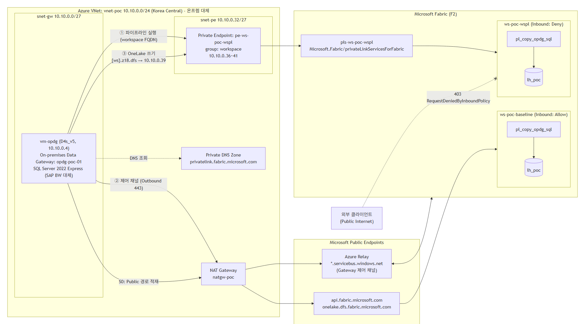
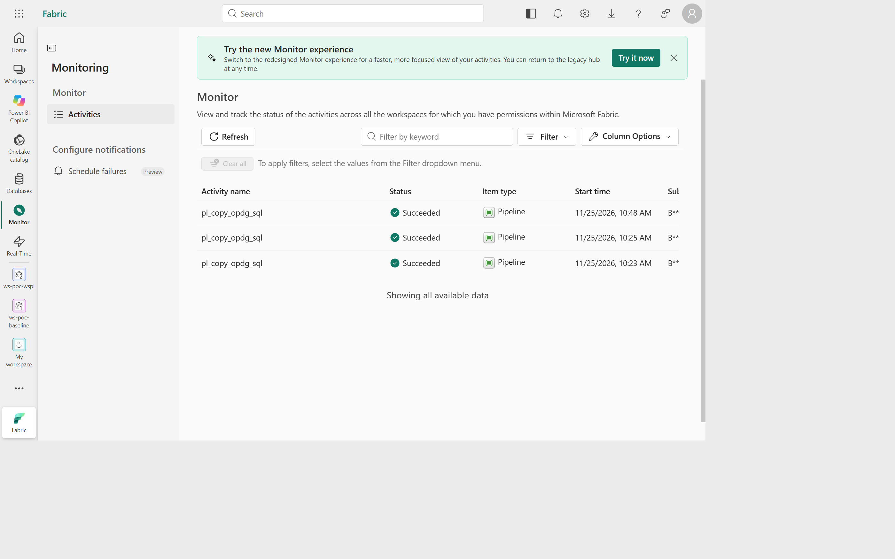
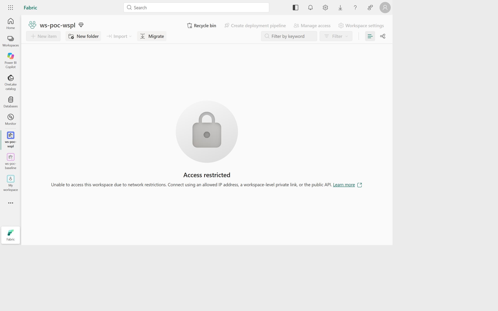
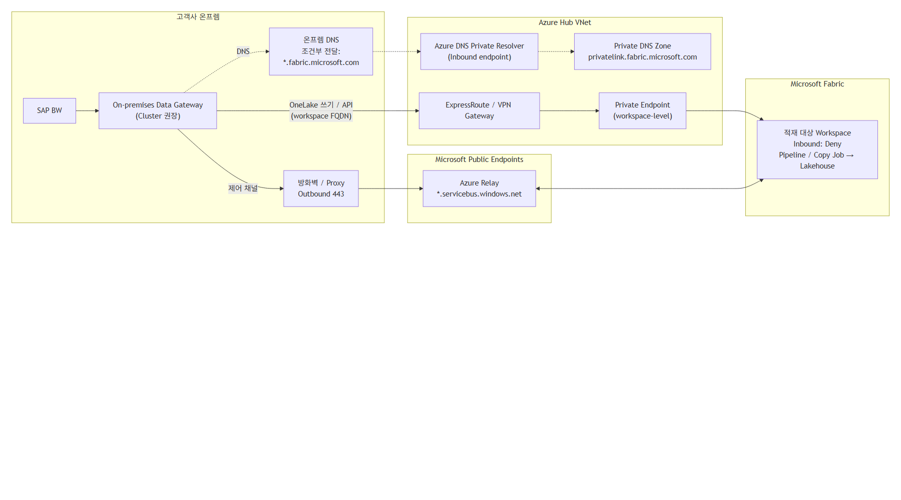

# PoC 결과 보고서: On-premises Data Gateway + Fabric Private Link 적재 검증

| 항목 | 내용 |
|---|---|
| 수행일 | 2026-11-25 (시간은 UTC 기준) |
| 수행 환경 | Azure Korea Central, Microsoft Fabric F2, 테스트 테넌트 |
| 수행 범위 | S0 (Baseline), S3 (Workspace-level Private Link) |
| 관련 문서 | [PoC 계획서](PoC-Plan-OPDG-Fabric-PrivateLink.md) · [환경 구성 가이드 (포털 캡처)](setup/Setup-Guide.md) |
| 마스킹 | 구독·테넌트·Workspace·Gateway·Job ID, UPN, Public IP |

---

## 1. 결론

> **Workspace-level Private Link로 적재 대상 Workspace의 Public 접근을 막은(Inbound Deny) 상태에서도, On-premises Data Gateway(OPDG)를 소스로 하는 Pipeline Copy 적재가 성공했습니다.**
> OPDG는 Workspace 전용 FQDN을 Private Endpoint IP로 조회해 OneLake에 직접 썼습니다.

| 질문 | 답 | 근거 |
|---|---|---|
| OPDG로 Private Link가 적용된 Fabric에 적재할 수 있나? | **Workspace-level Private Link: 가능 (실측)** | S3-a 성공 |
| 데이터는 Private 경로로 들어가나? | **예.** OneLake 쓰기는 `{ws}.z18.dfs.fabric.microsoft.com` → **10.10.0.39 (PE)** | Gateway 로그 + VM DNS 결과 |
| Public 경로는 정말 막히나? | **예.** Workspace 밖에서 호출하면 `403 RequestDeniedByInboundPolicy`, 포털에서는 *Access restricted* | S3-2, 아래 포털 캡처 |
| OPDG가 Public 통신을 전혀 안 하나? | **아니오.** 제어 채널은 Azure Relay(`*.servicebus.windows.net`)로 나가는 **Public Outbound 443**을 사용 | Gateway 로그 |
| 사전 조건은? | Fabric 관리자가 테넌트 설정 **"Configure workspace-level inbound network rules"**를 켜야 함. F SKU Capacity 필요 | S3-1에서는 차단, 설정을 켠 뒤 성공 |
| Dataflow Gen2도 되나? | 미검증. 문서상 Workspace-level Private Link에서는 **VNet Data Gateway 필수** | [지원 시나리오](https://learn.microsoft.com/en-us/fabric/security/security-workspace-level-private-links-support) |

### PoC 구성과 데이터 경로

| 번호 | 흐름 | 경로 |
|---|---|---|
| ① | 파이프라인 실행 (VM → Workspace API) | `{ws}.z18.w.api.fabric.microsoft.com` → PE 10.10.0.36 |
| ② | Gateway 제어 채널 | NAT Gateway → Azure Relay (Public) |
| ③ | OneLake 데이터 쓰기 (OPDG → Lakehouse) | `{ws}.z18.dfs.fabric.microsoft.com` → PE 10.10.0.39 |

**운영 적용 판단:** 기술적으로 동작하는 것은 확인했습니다. 다만 Microsoft 문서는 "OPDG + Private Link 미지원"을 Tenant-level 기준으로 설명하고 있고, OPDG + Workspace-level 조합이 지원되는지는 명시하지 않았습니다. 운영에 적용하기 전에 **Microsoft 지원 케이스 또는 제품팀을 통해 공식 지원 여부를 확인**해야 합니다.

---

## 2. 시나리오별 결과

| ID | 조건 | 수행 내용 | 결과 | 증적 |
|---|---|---|---|---|
| S0 | Private Link 없음 (`ws-poc-baseline`) | Pipeline Copy: SQL Server → OPDG → Lakehouse, Public API로 실행 | ✅ 성공 | Job `cbe4****`, 01:23:53~01:24:45, rowsRead/rowsCopied = **100,000**, Copy 38.6초 |
| S3-pre | `ws-poc-wspl`, Private Link 적용 전 (대조군) | 같은 Pipeline | ✅ 성공 | Job `7837****`, 01:25:22~01:26:02, rowsCopied = **100,000**, Copy 27.5초 |
| S3-1 | PLS/PE/DNS 구성 완료, **테넌트 설정 OFF** | ① Inbound Deny 설정 ② VM에서 Workspace FQDN으로 실행 | ⛔ 차단 | ① `403 InboundRestrictionNotEligible`. 빈 Workspace에서도 같아서 원인은 테넌트 설정으로 확인 ② `403 RequestDeniedByInboundPolicy` |
| S3-2 | 테넌트 설정 ON, `ws-poc-wspl` **Inbound Deny** (01:47:57 적용) | VNet 밖(Public)에서 API 호출 | ✅ 거부됨 (예상대로) | 01:48:11 `403 RequestDeniedByInboundPolicy`. 적용 후 1분 안에 반영 (문서상 최대 30분) |
| **S3-a** | 테넌트 설정 ON, Inbound Deny | VM에서 **Workspace FQDN(PE 경로)**으로 Pipeline 실행, 소스는 OPDG | ✅ **성공** | Job `82b6****` Completed, rowsRead/rowsCopied = **100,000** |
| S3-b | 같은 조건 | Dataflow Gen2 + OPDG | ➖ 미수행 | 문서상 VNet Data Gateway 필수 |

| 실행 이력 (Fabric Monitor) | Public 네트워크에서 제한 Workspace 접근 |
|---|---|
|  |  |

원본 데이터: [docs/results.json](docs/results.json)

---

## 3. 네트워크 경로 검증

### 3.1 VM(`vm-opdg`)에서 이름 조회 및 TCP 443 결과

| FQDN | 조회된 IP | 경로 | TCP 443 |
|---|---|---|---|
| `api.fabric.microsoft.com` | 20.41.\*.\* | Public | OK |
| `onelake.dfs.fabric.microsoft.com` | 20.41.\*.\* | Public | OK |
| `{ws}.z18.w.api.fabric.microsoft.com` | **10.10.0.36** | Private Endpoint | OK |
| `{ws}.z18.onelake.fabric.microsoft.com` | **10.10.0.38** | Private Endpoint | OK |
| `{ws}.z18.dfs.fabric.microsoft.com` | **10.10.0.39** | Private Endpoint | OK |
| `{ws}.z18.blob.fabric.microsoft.com` | **10.10.0.40** | Private Endpoint | OK |

### 3.2 OPDG가 실제로 접속한 엔드포인트 (Gateway 로그에서 추출)

| 엔드포인트 | 조회된 IP | 해석 |
|---|---|---|
| `{ws-poc-wspl}.z18.dfs.fabric.microsoft.com` | **10.10.0.39** | 제한 Workspace의 OneLake 쓰기에 **Private Endpoint 사용** |
| `{ws-poc-baseline}.zd6.dfs.fabric.microsoft.com` | 20.41.\*.\* | 공개 Workspace(S0)의 OneLake 쓰기는 Public |
| `onelake.dfs.fabric.microsoft.com` | 20.41.\*.\* | 공용 OneLake 엔드포인트 |
| `dmts-crelay-prod-cus-*.servicebus.windows.net` | 172.212.\*.\*, 40.84.\*.\* | Gateway 제어 채널 (Azure Relay, Public Outbound) |

**해석:** Pipeline Copy + OPDG 구성에서는 OPDG가 직접 Workspace 전용 FQDN(`{ws}.z{xy}.dfs`)으로 데이터를 씁니다. 따라서 **OPDG 서버가 이 FQDN을 Private Endpoint IP로 조회할 수 있어야** 합니다. 고객사 온프렘 환경에서는 온프렘 DNS에서 Azure DNS Private Resolver로 조건부 전달을 구성하고, ExpressRoute/VPN 경로가 있어야 합니다(PoC에서는 미검증).

---

## 4. 계획 대비 변경 사항

| 계획 | 실제 수행 | 사유 |
|---|---|---|
| VM 접속은 Azure Bastion | **Azure Run Command** (managed, protected parameters) | 자동화를 위해. Public IP와 Bastion 없이 구성 |
| OPDG를 사용자 계정으로 등록 | **서비스 주체**(`sp-***-opdg-poc`)로 등록하고 사용자를 Admin으로 추가 | 자동 설치를 위해 |
| Copy Job, Pipeline, Dataflow Gen2 | **Pipeline Copy만** 수행 | Dataflow Gen2는 문서상 VNet Gateway 필수. Copy Job은 후속 과제 |
| 테넌트 설정은 사전에 확인 | 수행 중 차단(S3-1)되어 Fabric 관리자가 켬 | 수행 계정이 Global Reader 권한만 보유 |

---

## 5. 한계 및 후속 과제

| 구분 | 내용 | 권장 조치 |
|---|---|---|
| 소스 | SAP BW 대신 SQL Server 2022 Express 사용 | Pipeline/Copy Job의 SAP BW 커넥터 지원 범위와 OPDG 버전 요구사항 확인 |
| 네트워크 | 온프렘 대신 단일 VNet 사용. ExpressRoute/VPN과 온프렘 DNS 전달은 미검증 | 고객사 네트워크에서 `{ws}.z{xy}.*.fabric.microsoft.com`이 PE IP로 조회되는지 확인 |
| 지원 정책 | OPDG + Workspace-level Private Link 공식 지원 여부가 문서에 명시되지 않음 | Microsoft 지원 케이스 또는 제품팀 확인 |
| 미수행 시나리오 | Copy Job, Dataflow Gen2(S3-b) | 필요 시 추가 PoC |
| 운영 제약 | Inbound Deny가 걸린 Workspace는 Public 네트워크에서 포털/API 접근 불가 | 운영자 접속 경로(PE 연결 VNet, VDI 등) 설계 필요 |

---

## 6. 권장 구성 (안)

1. 적재 대상 Workspace에만 **Workspace-level Private Link + Inbound Deny**를 적용합니다(F SKU).
2. 온프렘 OPDG는 Cluster로 구성합니다. 소스는 SAP BW이고, 적재는 **Pipeline Copy 또는 Copy Job**으로 합니다.
3. 온프렘 DNS에서 `*.fabric.microsoft.com`을 **Azure DNS Private Resolver**로 조건부 전달하고, ExpressRoute/VPN으로 PE에 접근합니다.
4. 방화벽이나 Proxy에서 **Azure Relay(`*.servicebus.windows.net`) Outbound 443**을 허용합니다.
5. 운영 적용 전에 Microsoft 공식 지원 여부를 확인합니다.

---

## 7. 저장소 구성

| 경로 | 내용 |
|---|---|
| `README.md` | PoC 결과 보고서 (이 문서) |
| [PoC-Plan-OPDG-Fabric-PrivateLink.md](PoC-Plan-OPDG-Fabric-PrivateLink.md) | PoC 계획서 |
| [setup/Setup-Guide.md](setup/Setup-Guide.md) | 환경 구성 가이드 (단계별 설정값, Azure·Fabric 포털 캡처) |
| [docs/](docs) | 아키텍처 다이어그램(`.mmd`/`.png`), 결과 원본 데이터(`results.json`) |

현재 리소스 상태: VM은 **Deallocated**, Capacity는 **Paused**, `ws-poc-wspl` Inbound는 **Deny 유지**입니다. 자세한 내용은 [구성 가이드 9장](setup/Setup-Guide.md#9-현재-리소스-상태-및-정리)을 참고하세요.
