# 환경 구성 가이드: OPDG + Fabric Workspace-level Private Link PoC

> PoC 결과는 [메인 README](../README.md)에 있습니다. 이 문서는 테스트 환경을 **어떻게 구성했는지**를 단계별로 정리합니다.
> 캡처에서 구독·테넌트·Workspace·Gateway ID, UPN, 사용자 이름, Public IP는 마스킹되어 있습니다.
> 캡처 시점에 VM은 Deallocated, Capacity는 Paused 상태였습니다.

## 구성 순서

| 단계 | 구성 항목 |
|---|---|
| 0 | 사전 조건 |
| 1 | 리소스 그룹, 네트워크 (VNet/Subnet/NAT/NSG) |
| 2 | Gateway VM (온프렘 대체) |
| 3 | 소스 DB (SQL Server Express, SAP BW 대체) |
| 4 | Fabric Capacity, Workspace, Lakehouse |
| 5 | On-premises Data Gateway 설치 및 등록 |
| 6 | Gateway 연결, Copy Pipeline |
| 7 | Workspace-level Private Link (PLS, PE, DNS) |
| 8 | 테넌트 설정, Workspace Inbound Deny |
| 9 | 현재 리소스 상태 및 정리 |

---

## 0. 사전 조건

| 항목 | 값 / 요구사항 |
|---|---|
| 리전 | Korea Central |
| Azure 권한 | 구독 Contributor 이상 (네트워크, VM, Fabric Capacity 생성) |
| Entra 권한 | App 등록 가능 (OPDG 등록용 서비스 주체) |
| Fabric 권한 | Workspace Admin. 테넌트 설정 변경은 **Fabric 관리자** 필요 |
| 리소스 공급자 | `Microsoft.Fabric` 등록 및 재등록 (Workspace-level Private Link를 처음 쓸 때) |
| 로컬 도구 | Azure CLI, PowerShell 7 |
| 비밀값 보관 | 저장소에 포함하지 않음 |

---

## 1. 리소스 그룹 및 네트워크

| 리소스 | 설정 |
|---|---|
| Resource Group | `rg-***-fabric-gw-poc` |
| VNet | `vnet-poc` 10.10.0.0/24 |
| Subnet `snet-gw` | 10.10.0.0/27. Gateway VM용, NAT Gateway와 NSG 연결 |
| Subnet `snet-pe` | 10.10.0.32/27. Private Endpoint용 |
| NAT Gateway | `natgw-poc` + `pip-natgw-poc`. OPDG가 Azure Relay와 Fabric 제어 채널로 나가는 Outbound 통신용 |
| NSG | `nsg-snet-gw`. 기본 규칙만 사용하며 Inbound 인터넷 허용 없음 |

**리소스 그룹 전체 리소스**

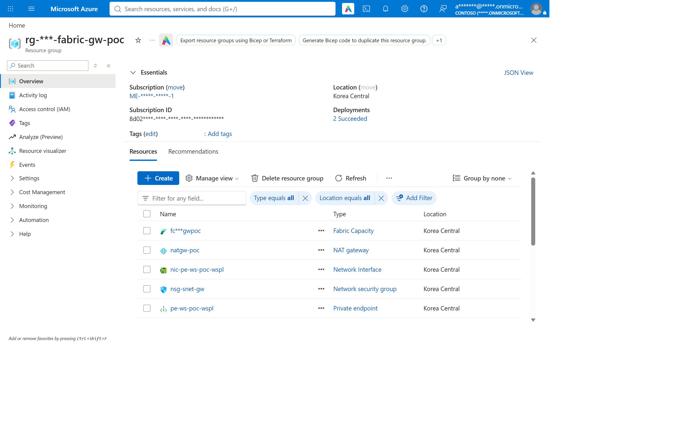

**VNet Subnet 구성**

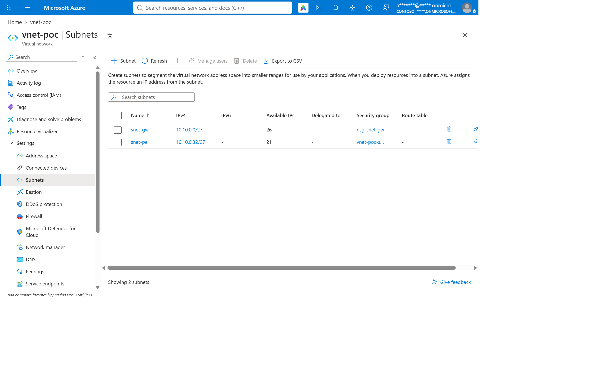

**NAT Gateway**

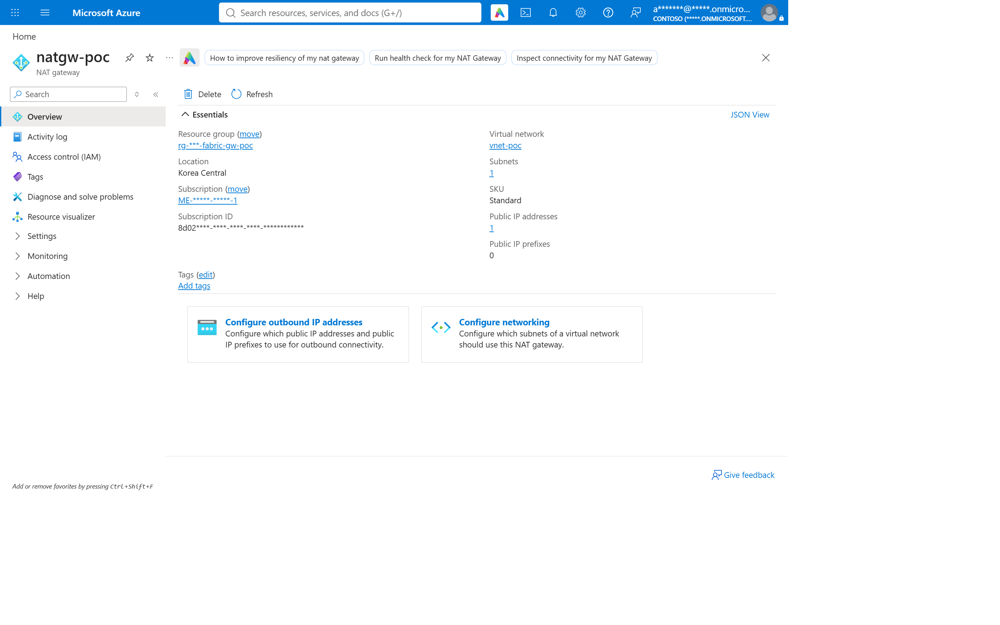

---

## 2. Gateway VM (온프렘 대체)

| 항목 | 값 |
|---|---|
| 이름 | `vm-opdg` |
| 크기 | Standard_D4s_v5 (4 vCPU / 16 GB) |
| OS | Windows Server 2022 Datacenter Azure Edition |
| 디스크 | Premium SSD 128 GB |
| 네트워크 | `snet-gw`, 사설 IP 10.10.0.4, **Public IP 없음** |
| 접속 방식 | Azure Run Command (managed, protected parameters). Bastion 미사용 |

**VM 개요**

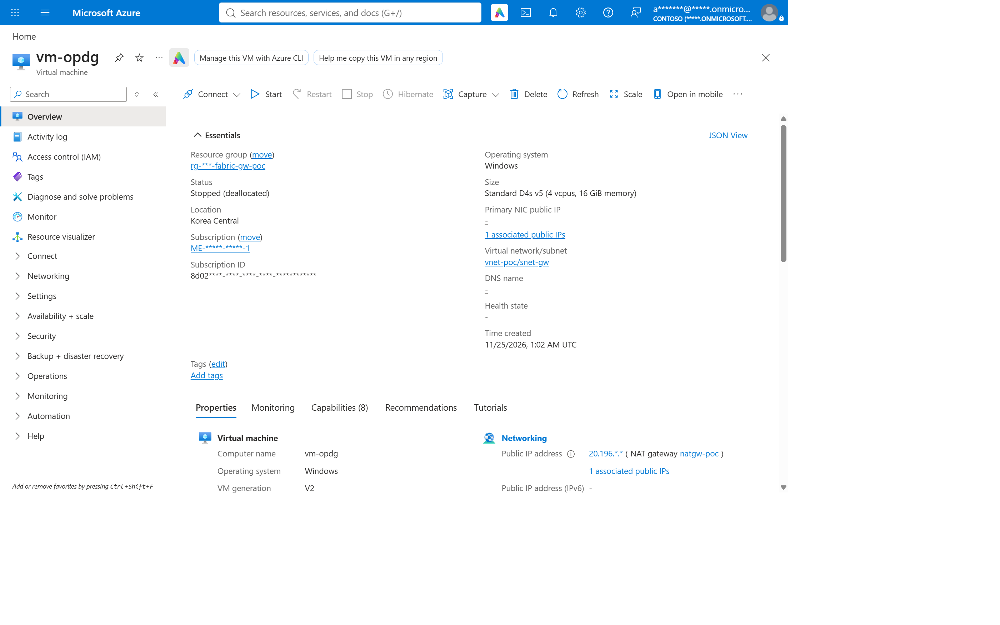

**VM 네트워크 설정 (Public IP 없음)**

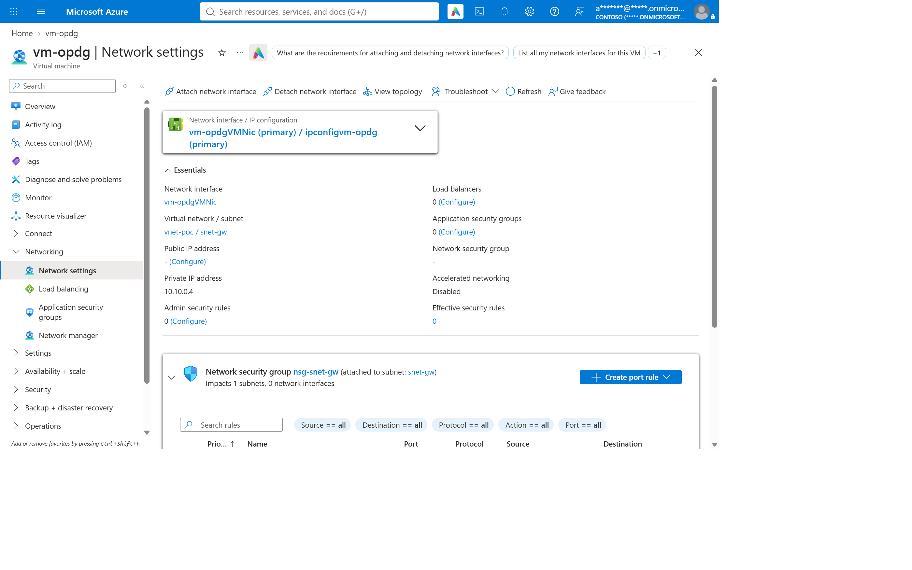

---

## 3. 소스 DB (SQL Server Express, SAP BW 대체)

| 항목 | 값 |
|---|---|
| 제품 | SQL Server 2022 Express (`SQLEXPRESS`) |
| 인증 | SQL 인증 (mixed mode) |
| 포트 | TCP 1433 (고정) |
| 데이터 | `pocdb.dbo.sales_sample` 100,000행 |

VM에 Run Command로 설치합니다. SA 비밀번호는 protected parameter로 전달합니다.

---

## 4. Fabric Capacity, Workspace, Lakehouse

| 항목 | 값 |
|---|---|
| Capacity | F2, Korea Central. Trial Capacity는 Private Link를 지원하지 않음 |
| Workspace | `ws-poc-baseline` (S0, Inbound Allow), `ws-poc-wspl` (S3, Inbound Deny) |
| Lakehouse | 각 Workspace에 `lh_poc` |

**Fabric Capacity**

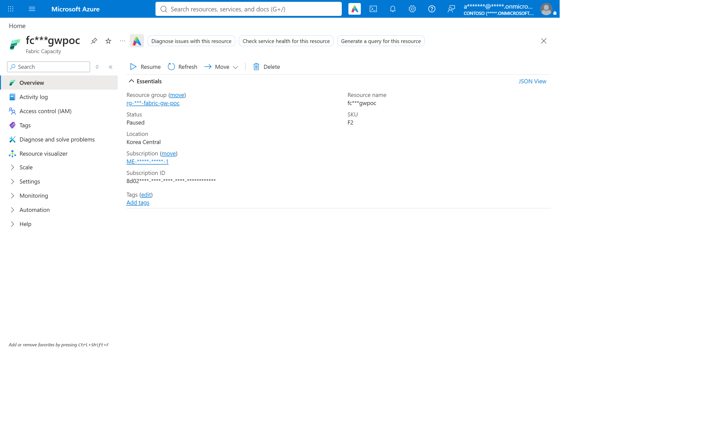

**ws-poc-baseline 항목**

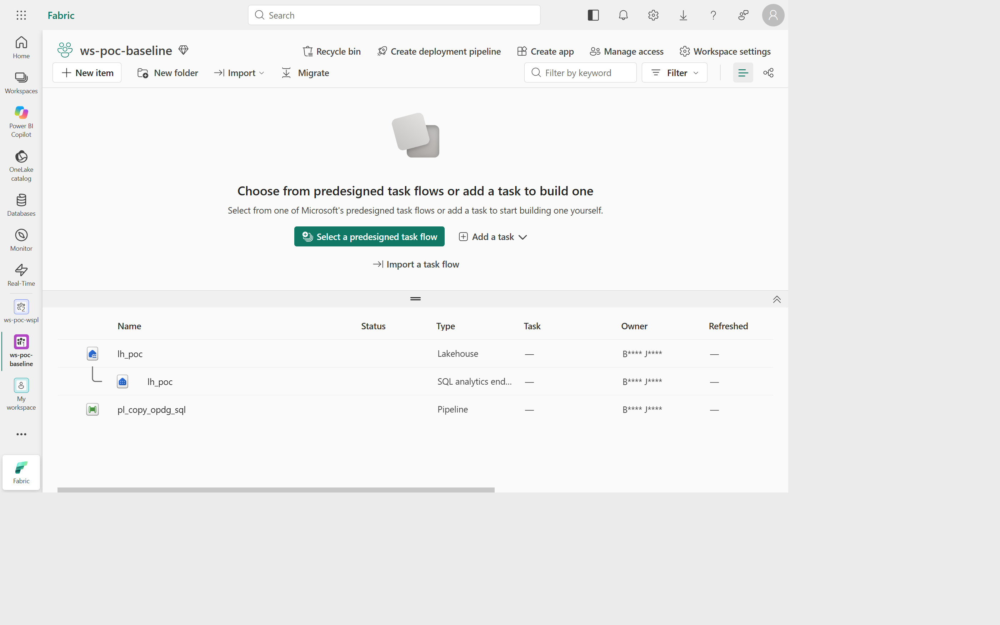

> `ws-poc-wspl`에는 Semantic Model, Deployment Pipeline 같은 미지원 항목을 만들지 않습니다. 이런 항목이 있으면 Inbound 제한을 켤 수 없습니다.

---

## 5. On-premises Data Gateway 설치 및 등록

| 항목 | 값 |
|---|---|
| Gateway 이름 | `opdg-poc-01` (Standard mode, 단일 멤버) |
| 버전 | 3000.342.5 |
| 등록 방식 | DataGateway PowerShell 모듈 + 서비스 주체 `sp-***-opdg-poc`, 사용자를 Gateway Admin으로 추가 |
| 등록 시점 | Private Link 적용 **전** |

순서는 다음과 같습니다.
1. PowerShell 7을 설치합니다.
2. `DataGateway` 모듈을 설치합니다.
3. `Connect-DataGatewayServiceAccount`로 로그인합니다(서비스 주체).
4. `Install-DataGateway -AcceptConditions`로 Gateway를 설치합니다.
5. `Add-DataGatewayCluster`로 등록합니다.
6. `Add-DataGatewayClusterUser`로 사용자를 Admin에 추가합니다.

**On-premises data gateway (Fabric > Manage connections and gateways)**

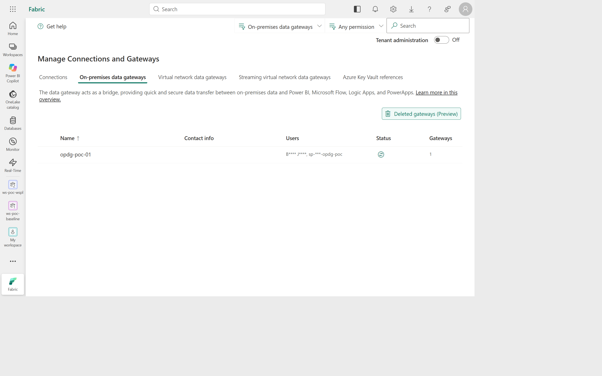

---

## 6. Gateway 연결 및 Copy Pipeline

| 항목 | 값 |
|---|---|
| 연결 | `conn-opdg-sql-pocdb`, OnPremisesGateway / SQL / `vm-opdg;pocdb` / Basic 인증 |
| 자격 증명 | Gateway 공개 키로 암호화해 REST API로 생성 |
| Pipeline | `pl_copy_opdg_sql`: Copy (SqlServerTable `dbo.sales_sample` → LakehouseTable `sales_sample`, OverwriteSchema) |

**Gateway 연결**

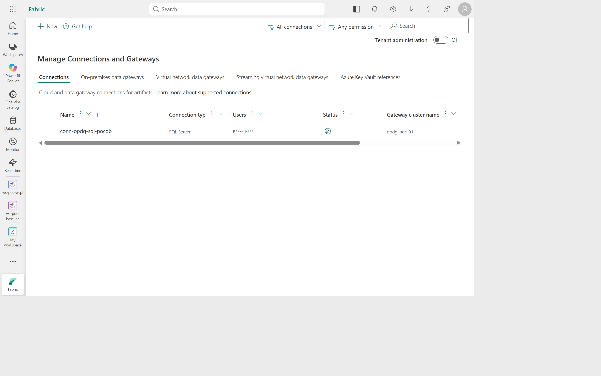

---

## 7. Workspace-level Private Link (PLS, Private Endpoint, DNS)

| 리소스 | 설정 |
|---|---|
| Private Link Service | `pls-ws-poc-wspl`. 타입 `Microsoft.Fabric/privateLinkServicesForFabric`, location `global`, ARM 배포 (숨겨진 리소스) |
| Private Endpoint | `pe-ws-poc-wspl`, `snet-pe`, target sub-resource `workspace` |
| Private DNS Zone | `privatelink.fabric.microsoft.com`. `vnet-poc`에 Link하고 DNS Zone Group으로 자동 등록 |
| PE IP | 10.10.0.36 (`w.api`), .37 (`c`), .38 (`onelake`), .39 (`dfs`), .40 (`blob`), .41 (`sqldw ext`) |

**Private Endpoint**

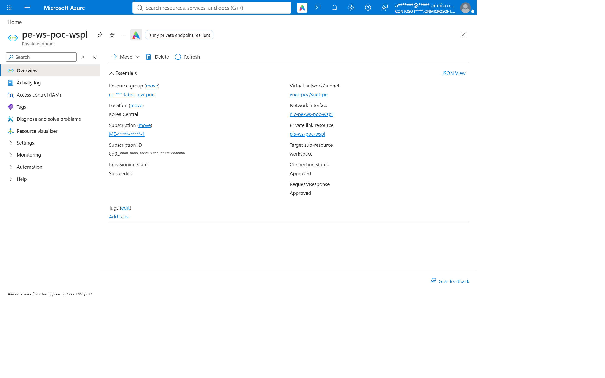

**Private Endpoint DNS 구성 (Workspace FQDN → Private IP)**

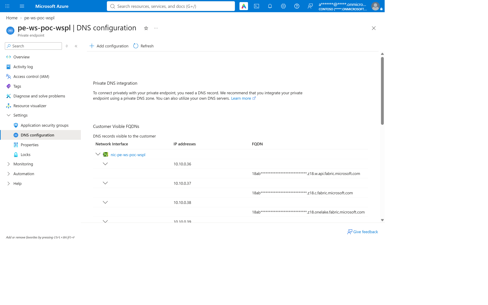

**Private DNS Zone 레코드**

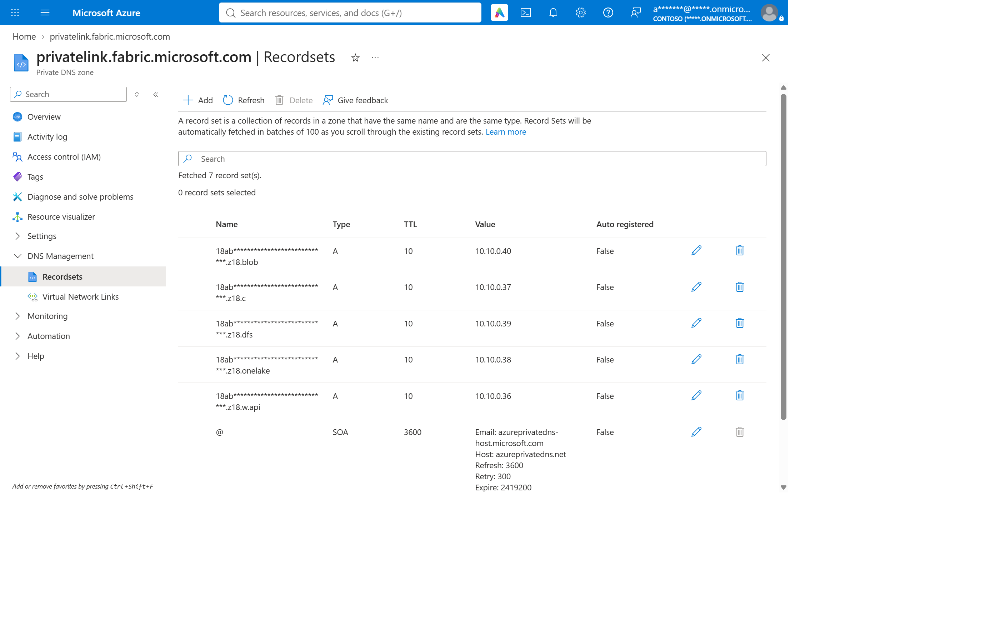

---

## 8. 테넌트 설정 및 Workspace Inbound Deny

1. Fabric 관리 포털에서 **Tenant settings > "Configure workspace-level inbound network rules"**를 **Enabled**로 바꿉니다(Fabric 관리자 필요).
   - 이 설정이 꺼져 있으면 Deny 설정이 `403 InboundRestrictionNotEligible`로 거부됩니다.
2. Workspace communication policy를 Deny로 설정합니다.
   ```http
   PUT https://api.fabric.microsoft.com/v1/workspaces/{workspaceId}/networking/communicationPolicy
   { "inbound": { "publicAccessRules": { "defaultAction": "Deny" } } }
   ```
3. VNet 밖(Public)에서 Workspace API를 호출해 `403 RequestDeniedByInboundPolicy`가 반환되는지 확인합니다(문서상 최대 30분, PoC에서는 1분 이내).

**테넌트 설정**

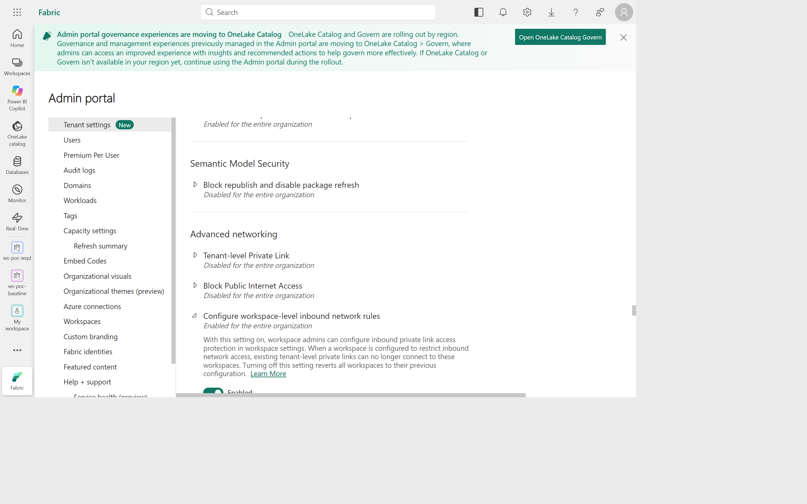

**Inbound Deny 적용 후 Public 네트워크에서 Workspace에 접근한 화면**

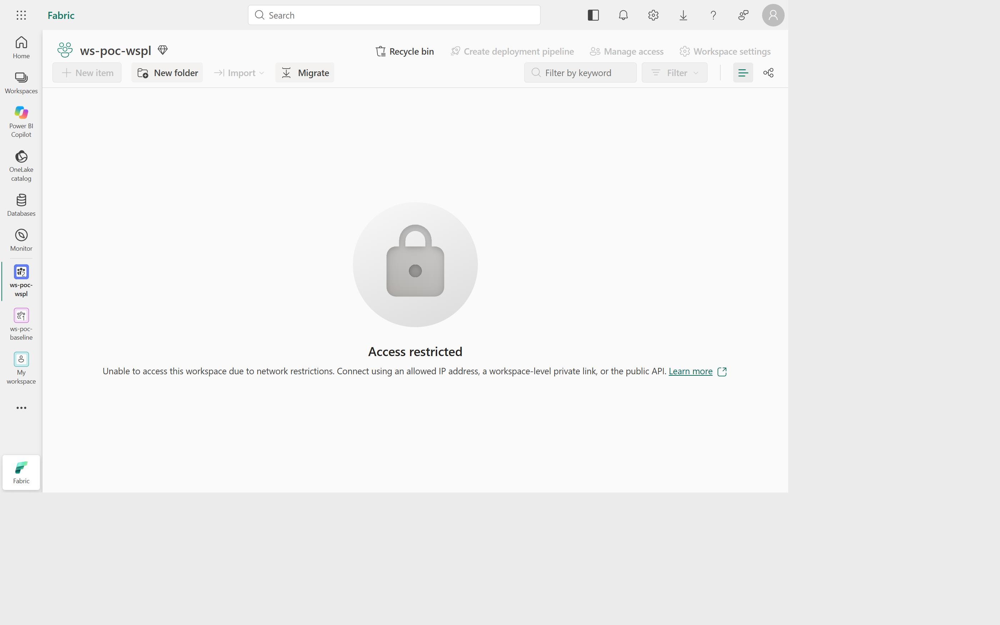

**Pipeline 실행 이력 (Fabric Monitor)**

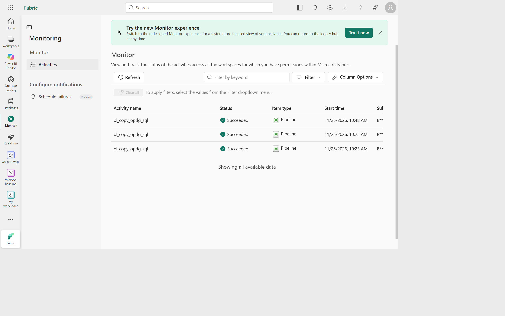

---

## 9. 현재 리소스 상태 및 정리

| 리소스 | 상태 |
|---|---|
| VM `vm-opdg` | 정지 (Deallocated) |
| Fabric Capacity (F2) | 일시 중지 (Paused) |
| NAT Gateway, Public IP, Private Endpoint, DNS | 유지 (NAT Gateway와 PE는 시간당 과금) |
| `ws-poc-wspl` Inbound 정책 | Deny 유지 (재테스트용) |
| 테넌트 설정 "Configure workspace-level inbound network rules" | ON |

전체를 삭제하려면 다음 순서로 진행합니다.
1. `ws-poc-wspl` 정책을 Allow로 되돌립니다.
2. Workspace를 삭제합니다.
3. 리소스 그룹을 삭제합니다.
4. 서비스 주체를 삭제합니다.
5. 필요하면 테넌트 설정을 원복합니다.
